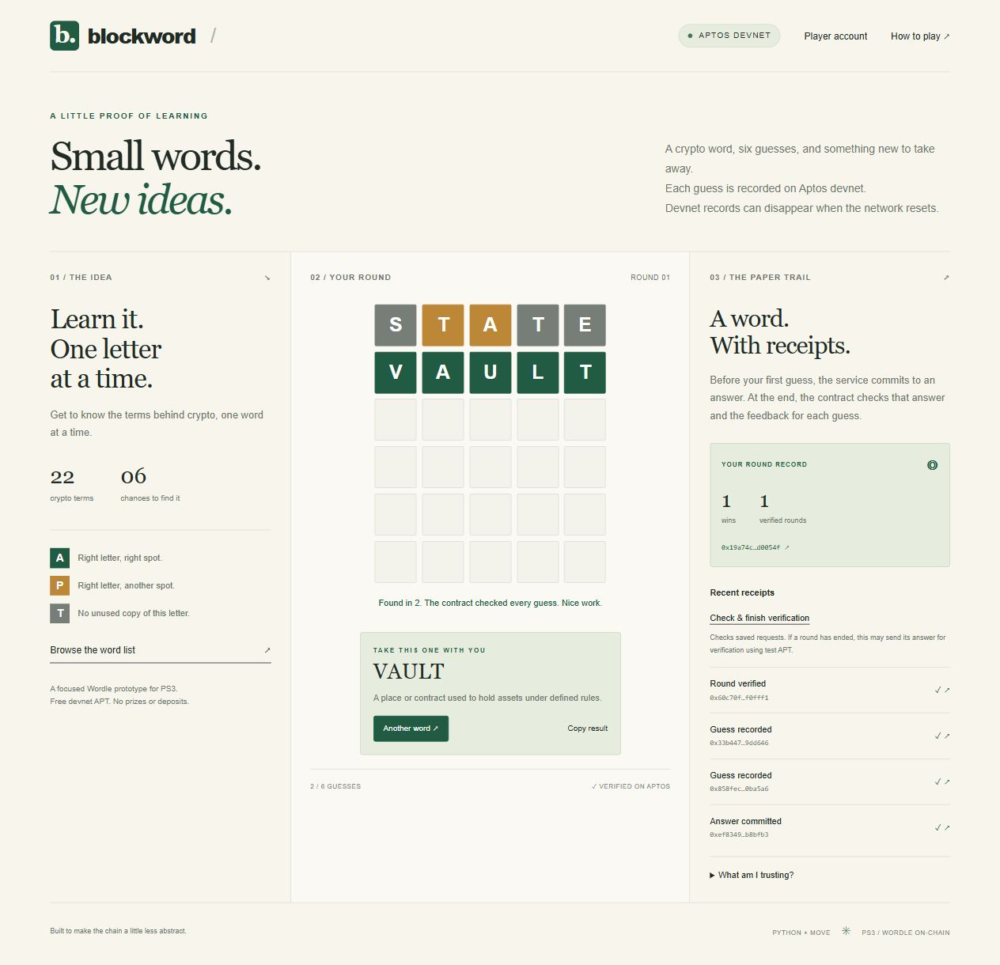

# checks and receipts

## hosted demo: 21 october 2026

live URL: **https://blockword-ps3-demo.vercel.app**. the site runs on vercel hobby with neon postgres. the database expires on **24 october 2026 at 17:46:59 UTC / 11:16 pm IST**. the existing aptos devnet module was checked again and reused.

- **87 python tests passed**, including six real postgres integration checks.
- **13 offline client tests passed**.
- the browser found VAULT in two guesses and showed the verified result.
- a separate HTTP round replayed every request id, then checked every receipt and the final `Game` resource against the fullnode.
- an early-reveal round also completed and was saved.
- live account checks covered a real disposable Ed25519 signature, replay rejection, profiles, cross-site rejection, history linking and session revocation.
- the profile, linked rounds and game session survived a production redeploy. reloading the browser kept its result; the captured console had no warnings or errors.
- public assets, API readiness, unsigned-account rejection and environment-file exclusion were checked.

the signature check used the live API and devnet, without a wallet extension. installed-wallet compatibility remains unverified.

some early command-line smoke attempts lost the HTTP connection. the runner now keeps private recovery cookies, reuses the request id after transport failures and uses a direct HTTP client. the final run passed. the browser completed its round without that issue.

| file | what it records |
| --- | --- |
| `hosted-game-verification.json` | hosted win, retries, receipts and fullnode reads |
| `hosted-account-verification.json` | live signatures, profile and request checks |
| `hosted-history-verification.json` | linked win and early reveal |
| `hosted-persistence-verification.json` | reads after redeploy and session revocation |
| `hosted-demo.png` | browser result |
| `../hosted-deployment.json` | public deployment metadata and expiry |



## earlier runs

these counts are snapshots of different versions, not extra tests to add to the final total.

| stage | result |
| --- | --- |
| initial prototype, 20 october | 19 python tests; 13 Move tests, including at the deployed address; bytecode matched the published module |
| six-agent review fixes | 39 python tests; four client tests; 13 Move tests from a scratch copy; contract source unchanged |
| player accounts | 63 python tests; 13 client tests; mocked-node signature, expiry, rotation, concurrency and private-history coverage |
| hosting preparation | 75 python tests; 13 client tests; HTTPS origin, host checks, cookies and forwarded-header coverage |
| vercel/postgres deployment | 87 python tests; 13 client tests; hosted checks listed above |

the initial API and browser rounds both finished in two guesses. browser reload restored the result; narrow-layout interaction and wide-layout overflow were checked. those checks do not establish broad device or screen-reader compatibility. the original receipts are `../deployment.json` and `../verification.json`; `preview.png` is the older browser capture.

the initial browser player was `0x790b566f6af216bca7304d680a7951330c6871317b05a0d23a3aa3e96578ebb0`. its verification transaction was `0xe6d73077e0eb4f4d171677b479c7afdd7199a44cccccbe8a16a27d71fa446351`.

no live transactions were sent during the six-agent review or the account-feature tests. live hosted checks came afterward. a Starlette TestClient deprecation warning appeared in the python runs; it did not fail the suite.

## run the checks

```text
python -m pytest -q
node --test tests/client.test.cjs tests/accounts-client.test.cjs
python -m compileall -q blockword scripts
node --check static/app.js
node --check static/accounts.mjs
aptos move test --package-dir contract --named-addresses blockword=0xcafe
```

set `BLOCKWORD_TEST_DATABASE_URL` to a disposable postgres database to run the six integration tests. they skip without it. the recorded contract checks used aptos CLI 9.6.0; the initial python run used 3.12.14.

`python scripts/check_deployment.py` reads the recorded deployment without sending transactions. `python scripts/smoke.py` plays a live round against the running app and writes receipts to `verification.json`.

devnet can reset, so old receipts don't prove availability today. the referee knows the answer and can stop a round from settling. the game uses server-held demo keys. see the [readme](../README.md) for those limits and [hosting](hosting.md) for the database lifetime.
